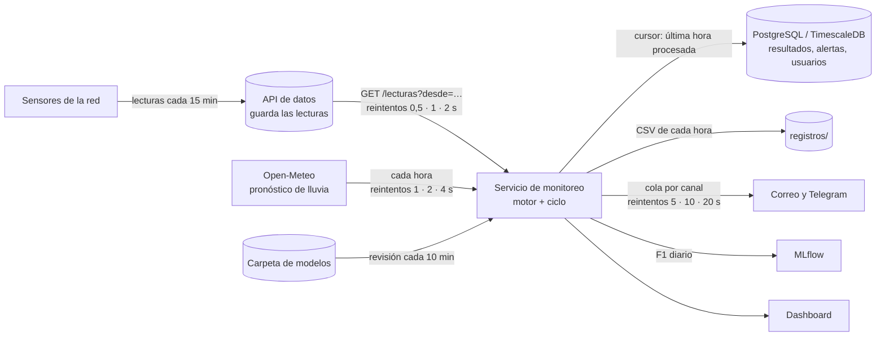

# Resiliencia del servicio de monitoreo (RNF-002)

Qué pasa cuando falla cada pieza del sistema, cómo se recupera y con qué pruebas se comprueba.
La idea general: **ninguna falla externa detiene el monitoreo ni hace perder horas de datos**. Lo
que no se puede procesar en el momento espera en una cola persistente y se procesa en orden al
volver, y si dejan de llegar datos se avisa a las personas responsables.

## Componentes y por dónde pasan los datos

**La cola persistente** son dos piezas juntas:

1. La **API de datos** guarda las lecturas que mandan los sensores; el servicio las pide con
   `desde=<última lectura recibida>`, así que nada se pierde mientras el servicio no las pida.
2. El **cursor** (`backend/monitoreo/cursor.py`, tabla `estado_servicio` en la base de datos) guarda
   la última hora procesada. Se actualiza después de procesar cada lote de horas.

Al reiniciar, el servicio lee el cursor, pide a la API las lecturas de los 31 días anteriores (la
historia que necesitan los modelos) y sigue con la hora siguiente: no repite horas ni se salta
ninguna. Con esas lecturas rearma también las historias largas que no caben en el búfer de 96 h:
la lluvia de 30 días de la anticipación, la semana de caudal y presión de las fugas y la semana de
la deriva (`Motor.reanudar` y `Motor._sembrar_historia`). Por último repasa las 192 horas anteriores
al cursor sin avisar ni registrar nada (`Motor._repasar`): así el dashboard tiene enseguida el estado
de cada sensor, las series de 7 días y las alarmas, avisos y fugas que seguían abiertos, en vez de
quedar en "Esperando las primeras lecturas" hasta que se procese la hora siguiente (hasta una hora
en operación).

## Modos de falla

| Falla | Qué pasa mientras dura | Al volver | Dónde está |
|---|---|---|---|
| **API de datos caída o sin red** (minutos u horas) | Cada consulta se reintenta 3 veces (0,5, 1 y 2 s); si sigue fallando, el ciclo vuelve a probar cada segundo. No se procesa ninguna hora y el cursor no avanza. El dashboard muestra "No están llegando datos" y `/health` da `degradado`. A los 60 min sin lecturas nuevas se avisa por correo y Telegram a todos los destinatarios | Se piden las lecturas desde la última recibida y se procesan **en orden todas las horas pendientes** en el mismo ciclo (~70 ms por hora). Se manda un aviso de que los datos volvieron | `cliente_datos.py`, `reintentos.py`, `Servicio.paso`, `Servicio.vigilar_datos` |
| **Los sensores dejan de mandar** (la API responde) | Si falla un solo sensor, sus huecos de hasta 30 min se interpolan y los más largos se marcan (`flag_imputacion`). Si no llega nada, no se cierran horas; a los 60 min se avisa ("la API de datos responde, pero no trae lecturas nuevas") | Igual que arriba | `calidad.lecturas_operativas`, `Servicio.vigilar_datos` |
| **El servicio se cae o se reinicia** | Docker lo vuelve a levantar (`restart: unless-stopped`). Las lecturas siguen llegando a la API | Sigue después del cursor, con la historia de 31 días rearmada (sin calentamiento de 96 h) y el dashboard con el estado de antes desde el primer ciclo (repaso de 192 h sin avisar ni registrar). `/api/estado` dice en `retomado` desde qué hora siguió | `cursor.py`, `Servicio._lecturas_al_arrancar`, `Motor.reanudar` |
| **La fuente de datos empezó de nuevo** (p. ej. el simulador reiniciado, o lecturas que no llegan hasta el cursor) | — | Se procesa desde el principio y el cursor se corrige | `Servicio._lecturas_al_arrancar` |
| **Base de datos caída** | El monitoreo sigue: los resultados de cada hora se escriben siempre en el CSV y las filas para la base esperan en memoria (hasta 50 000). Las alertas se notifican igual aunque no se puedan guardar para atenderlas. El cursor se intenta guardar en cada ciclo; `/health` lo dice | Las filas pendientes se escriben de una vez y el cursor se guarda | `Registro.escribir` (`motor.py`), `Servicio._guardar_cursor`, `alertas.py` |
| **Open-Meteo caído** | 4 intentos (esperas de 1, 2 y 4 s, 10 s de tiempo máximo cada uno). Si fallan, se sigue con el último pronóstico descargado y se vuelve a probar en 10 min, no en una hora. `/health` da `degradado` con el error | Se actualiza el pronóstico en la siguiente consulta | `pronostico_lluvia.py` |
| **Correo o Telegram fallan** | Cada canal manda desde su propio hilo y su cola, con 3 reintentos (5, 10 y 20 s): un canal caído no frena al motor ni al otro canal. En un reintento de correo solo se manda a quienes faltaban | Cada envío, logrado o no, queda en la tabla `notificaciones` (página Usuarios) | `alertas.py`, `correo.py` |
| **Modelos nuevos que no cargan** (un archivo a medio copiar, otra versión, otros sensores) | Se sigue con los modelos actuales; `/health` muestra el error | Se cargan en la siguiente revisión (cada 10 min) cuando estén completos, sin reiniciar el servicio | `Servicio.revisar_modelos` |
| **Los procesos de `/predict` no arrancan** | `/predict` se atiende en el proceso del servicio | — | `trabajadores.py`, `Servicio` |
| **MLflow caído** | El F1 diario se guarda igual en la base (`rendimiento_diario`) y el dashboard lo muestra; solo falta la corrida en MLflow | El día siguiente se registra normalmente | `rendimiento.py` |
| **Corte de luz de toda la máquina** | Todo se detiene | Docker levanta los servicios al encender (`restart: unless-stopped`, con el servicio de Docker iniciando con el sistema). PostgreSQL se recupera con su propio registro de transacciones. El monitoreo sigue desde el cursor | `docker-compose.yml` |

## Política de reintentos

| Destino | Intentos | Esperas | Tiempo máximo por intento | Si todos fallan |
|---|---|---|---|---|
| API de datos | 4 | 0,5 · 1 · 2 s | 30 s | el ciclo vuelve a probar en 1 s, sin límite |
| Open-Meteo | 4 | 1 · 2 · 4 s | 10 s | sigue con el último pronóstico; nuevo intento en 10 min |
| Correo y Telegram | 4 | 5 · 10 · 20 s | el del servidor | queda como `fallida` en `notificaciones` |
| MLflow | 1 | — | 5 s | ese día queda sin corrida en MLflow; el F1 queda en la base |

Las esperas crecen al doble (`reintentos.py`, con un máximo de 30 s). Los errores que no se
arreglan reintentando no se reintentan: un 4xx de la API de datos (pedido mal hecho) se lanza de
una vez; solo los 5xx y los errores de red se reintentan.

## Avisos de datos que no llegan

Si pasan **60 minutos** (reloj real, `SIN_DATOS_MIN` en el `.env`) sin ninguna lectura nueva, se
manda un aviso a todos los destinatarios del correo (los de las alertas críticas y los de las
predictivas) y a Telegram, porque mientras tanto el sistema no puede detectar nada. Dice desde
cuándo no llegan datos y si la API de datos no responde o responde sin lecturas. Se avisa una sola
vez, y otra cuando los datos vuelven, con cuánto tiempo estuvieron sin llegar.

## Supuestos y límites

- **La API de datos tiene que guardar las lecturas** mientras el servicio no las pide (la del
  simulador lo hace). Si la fuente definitiva solo transmitiera en vivo, las lecturas de un corte se
  perderían; en ese caso hace falta una cola delante (p. ej. que la API las guarde en la base de datos).
- **Las filas pendientes para la base viven en memoria.** Si el servicio se reinicia con la base
  caída, esas filas no llegan a la base, pero están en el CSV de la sesión (`registros/`), del que
  se pueden cargar.
- **Una alarma abierta antes de un reinicio** vuelve a necesitar sus horas de confirmación (3 h)
  para abrirse en el motor; en la gestión de alertas sigue abierta (se actualiza la misma, no se
  crea otra ni se vuelve a notificar), así que no se pierde el seguimiento.
- **El aviso de datos que no llegan usa el reloj real.** Con el simulador acelerado (`VELOCIDAD` > 1)
  los datos avanzan más rápido que el reloj, pero el aviso sigue midiendo minutos reales sin lecturas.
- **Docker reinicia contenedores, no la máquina.** Para que todo vuelva solo después de un corte de
  luz, Docker Desktop tiene que iniciar con Windows.

## Evidencia

Pruebas automáticas en `backend/pruebas/test_resiliencia.py` (corren en la integración continua):

| Prueba | Qué comprueba |
|---|---|
| `test_esperas_exponenciales`, `test_reintentar_*` | esperas 1, 2, 4 s; se rinde tras 4 intentos; no reintenta lo que no sirve |
| `test_api_de_datos_reintenta_caidas_y_errores_5xx`, `…_no_reintenta_un_pedido_mal_hecho` | reintentos de la API de datos; un 404 no se reintenta |
| `test_open_meteo_reintenta_y_si_falla_sigue_con_el_ultimo` | reintentos, último pronóstico y nuevo intento a los 10 min |
| `test_base_caida_las_filas_esperan_y_se_escriben_al_volver` | base caída dos veces: el CSV tiene todo y la base recibe las filas al volver |
| `test_sin_base_el_ciclo_sigue_y_el_cursor_se_guarda_al_volver` | sin base el ciclo no se cae y el cursor se guarda después |
| `test_cursor` | el cursor persiste entre instancias |
| `test_corte_de_mas_de_dos_horas_no_pierde_ninguna_hora` | API caída ~3 h con los sensores mandando: al volver se procesan todas las horas en orden y sin huecos |
| `test_reinicio_sigue_despues_del_cursor` | después de un reinicio no se repite ninguna hora y se piden solo 31 días de historia |
| `test_al_reanudar_el_dashboard_tiene_enseguida_el_estado_de_antes` | sin lecturas nuevas tras el reinicio, sensores, series, alarma abierta, anticipación y fugas quedan iguales que antes, sin avisar ni registrar otra vez |
| `test_al_reanudar_se_rearman_la_lluvia_de_30_dias_y_las_semanas_de_fugas_y_deriva` | la lluvia de hace 29 días cuenta y las fugas y la deriva ven su semana completa |
| `test_si_la_fuente_empezo_de_nuevo_se_procesa_desde_el_principio` | cursor más adelante que los datos: se procesa desde el principio y se corrige |
| `test_se_avisa_cuando_dejan_de_llegar_datos_y_cuando_vuelven`, `test_sensores_callados_con_la_api_funcionando` | aviso a los 60 min (no antes, una sola vez) y aviso al volver |

Las pruebas de los canales (reintentos del correo solo a quienes faltan, canales independientes)
están en `test_alertas.py` y `test_correo.py`.
